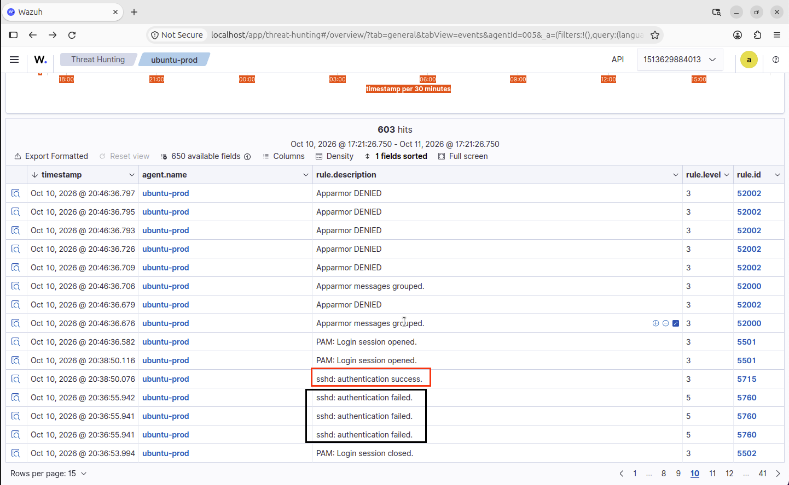
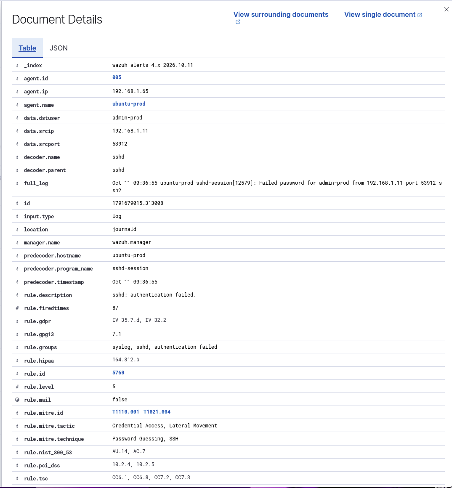
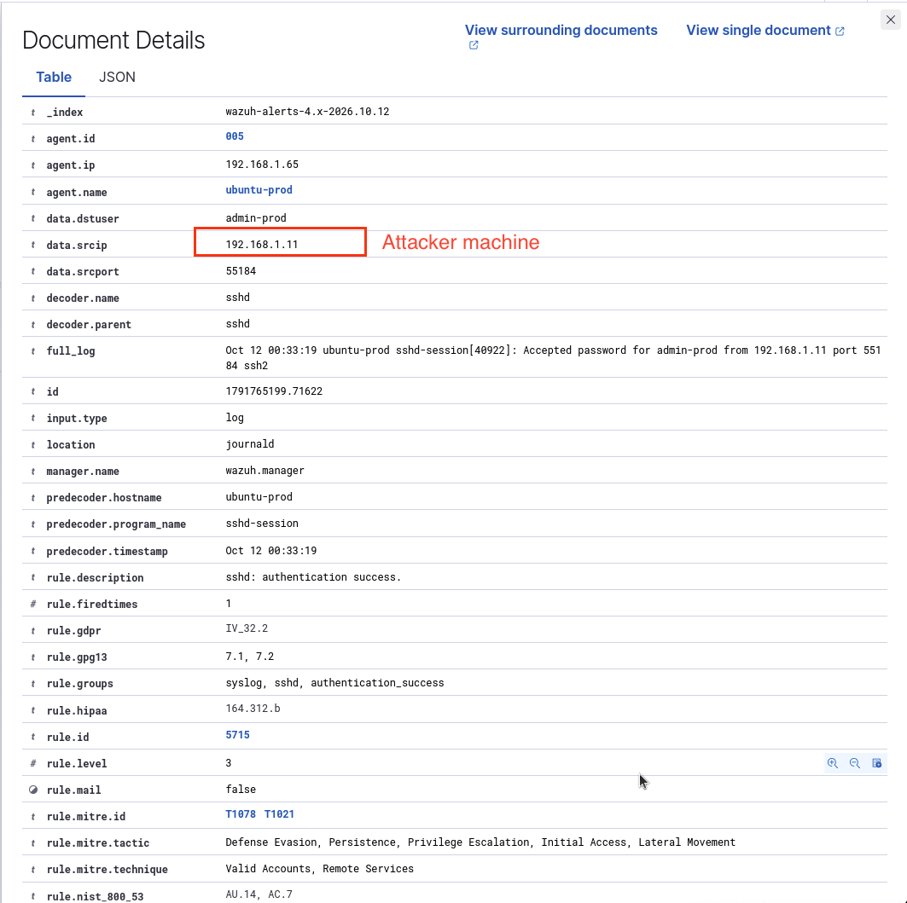
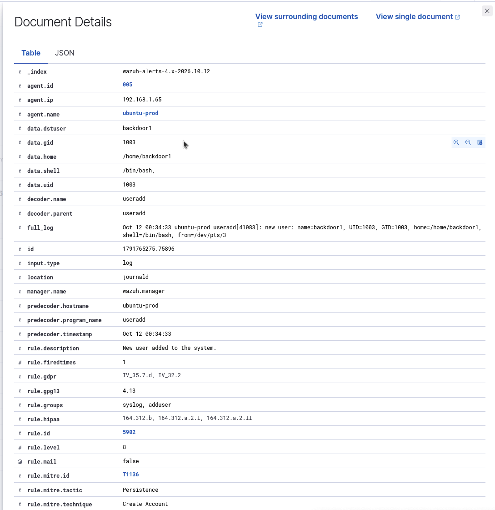
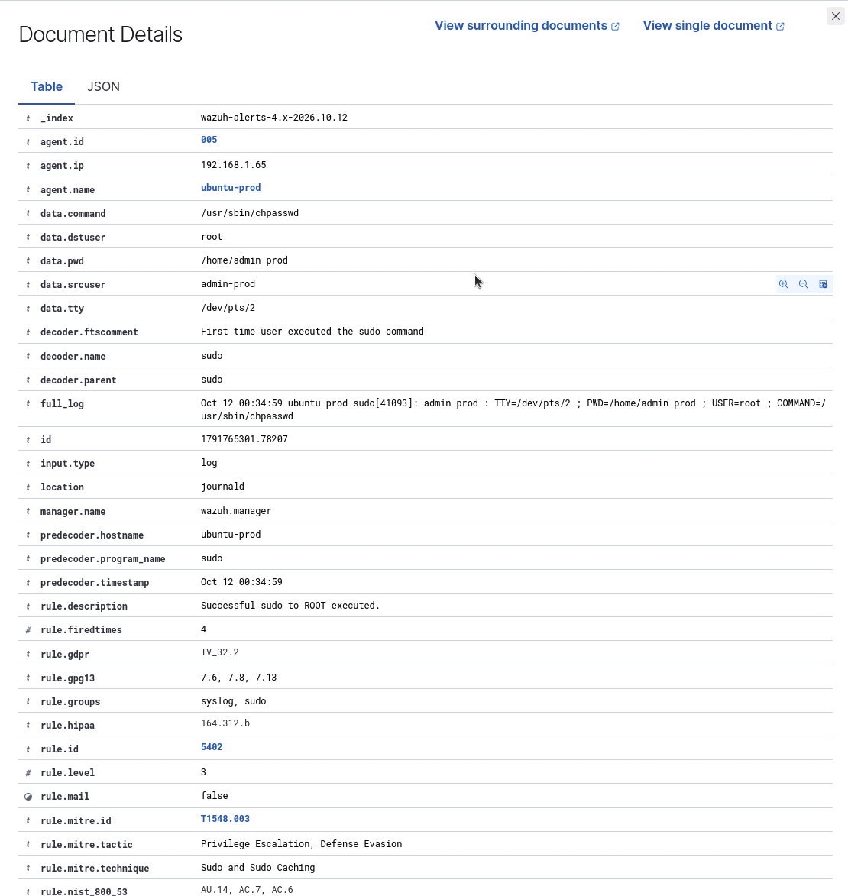
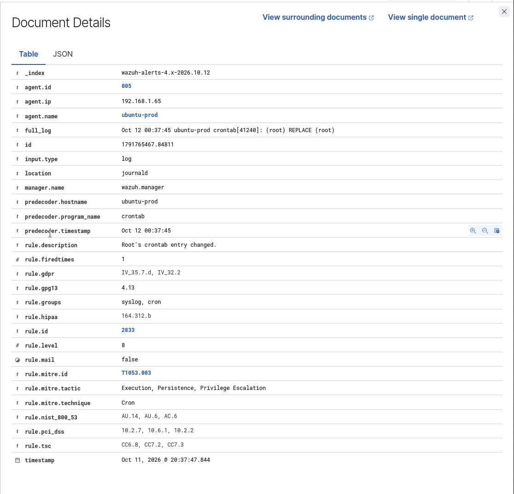

# Summary
A self-hosted SIEM lab where I deployed Wazuh in Docker, spun up a victim endpoint, and then ran MITRE ATT&CK techniques against it to test what the default ruleset actually detects and what it doesn't. Covers the log pipeline ingestion from the agent endpoints to the Wazuh Manager.

---

## Components


* Kali Linux VM (Attacker): Perform MITRE ATT&CK techniques (e.g., SSH brute force, privilege escalation).

* Ubuntu VM (Endpoint): Victim device
                                 
* Wazuh Agent: Installed on the endpoint, it ships logs via Port 1514/TCP.
                             
* Wazuh Server on Docker: Indexes and visualizes the data in the Dashboard via the web portal.


##  Prerequisites

### 1 - Docker Setup 
To install: https://docs.docker.com/engine/install/ubuntu/

### 2 - Wazuh installation via Docker
Instructions: https://documentation.wazuh.com/current/deployment-options/docker/wazuh-container.html
  * NOTE: Installation can be done as a single or multiple node stack, depending on your preference.

### Dashboard Monitoring

Open your browser and navigate to the Wazuh Web Console (`https://ip-of-SIEM-server`) and navigate to Threat Intelligence > Threat Hunting to see the security events.


### Detection results

#### * SSH Brute Force |  ATT&CK T1110.001 - Brute Force: Password Guessing

* **Victim:** account created with a weak password

```sudo useradd -m admin-prod && echo 'admin-prod:<weak-password>' | sudo chpasswd```

* **Attacker:** Used Hydra to perform brute force to log in.

```hydra -l amin-prod -P /usr/share/wordlists/rockyou.txt ssh://VICTIM_IP```

#### Results:

The first 3 attempts were logged, demonstrating the failed authentication. The last attempt by Hydra on the attacker's machine was successful in retrieving the weak password.



Each failed login was logged under rule 5760 (sshd: authentication failed). The brute-force correlation rule did not fire on this run — only 3 failures were recorded before Hydra found the password, below the default threshold of 8 failures in 120 seconds.



#### * Valid login after brute force |  ATT&CK T1078

Once logged in, the default rule 5715 was triggered once we were able to sign in from the attacker VM


#### * Create local user | ATT&CK T1136.001

To have persistent access to this server, we've created a local account:
```
sudo useradd -m -s /bin/bash backdoor
echo 'backdoor:Hacked123' | sudo chpasswd
sudo usermod -aG sudo backdoor1         
```
This was detected under default rule 5902.


#### * Sudo privilege escalation | ATT&CK T1548.003

To increase our privileges within our victim's system, we invoked `sudo` with `sudo -i`, this was also detected under rule ID 5402.



#### * Cron persistence | ATT&CK T1053.003

To further test our default detection capabilities, we ran a cron task to open a reverse-shell back to our attacker's VM. This was also covered by the default rule ID 2833.




